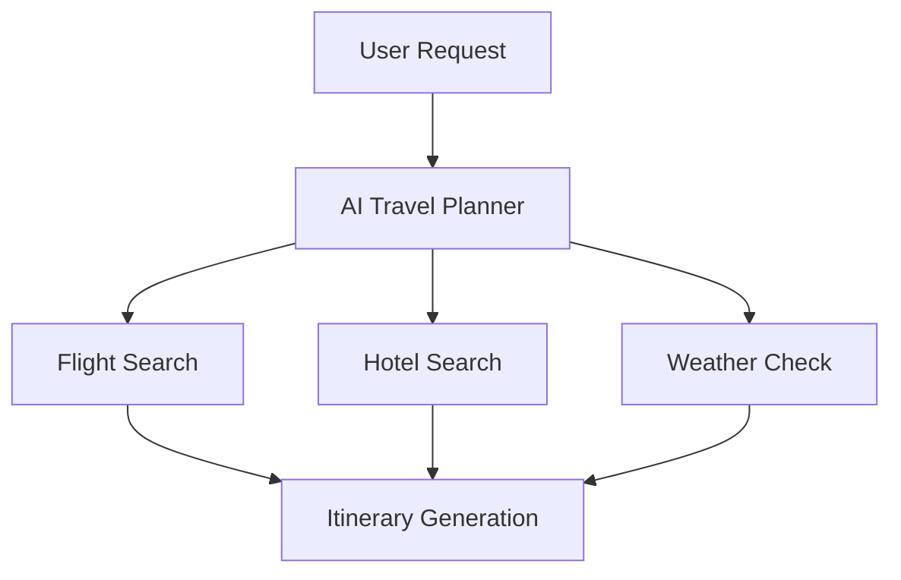

# Examples

This page shows how the MCP server capabilities can be used together for a representative agentic workflow.

## AI Travel Planner

### Overview

The AI Travel Planner is a simulated workflow used to demonstrate how the DeepAgentLabs MCP Server can inspect and test an agentic workflow.

The workflow represents a request to:

> Plan a 3-day trip to Goa.

The example includes simulated steps for:

1. Searching for flights
2. Searching for hotels
3. Checking weather
4. Generating a travel itinerary

> **Note:** This example is a simulated workflow. It does not connect to real flight, hotel, or weather APIs.

---

## Workflow

## Hosted access status

[`examples/hosted_access_status.py`](https://github.com/DeepAgentLabs/mcp-server/blob/main/examples/hosted_access_status.py)
calls `core.access_status` with a hosted key and then tries one tool
(`--tool`, default `core.version`). If the key's policy refuses the tool, it
prints the `mcp.access-decision.v1` denial record. See
[Hosted access control](access-control.md).

## Unified release check

[`examples/unified_release_check.py`](https://github.com/DeepAgentLabs/mcp-server/blob/main/examples/unified_release_check.py)
compares Lens runs, runs a local chaos experiment, and calls
`core.release_check` with an Evals report: first with chaos evidence missing,
then ready, then blocked by a latency threshold. It ends with
`core.incident_summary` and `core.export_report`. See
[Unified workflows](unified-workflows.md).
