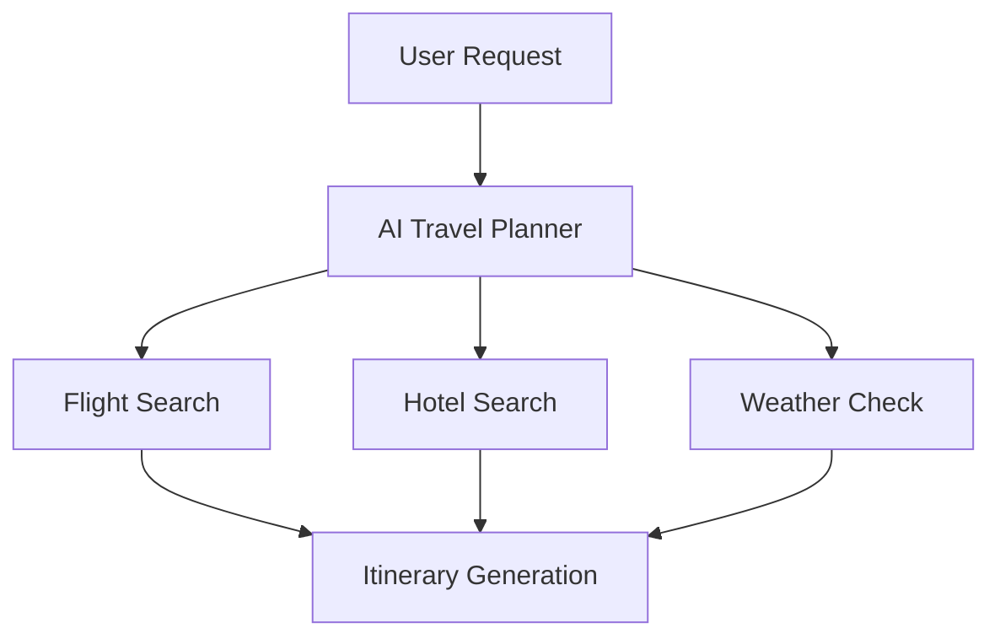

# Examples

This page shows how the MCP server capabilities can be used together for a representative agentic workflow.

## AI Travel Planner

### Overview

The AI Travel Planner is a simulated workflow used to demonstrate how the DeepAgentLabs MCP Server can inspect and test an agentic workflow.

The workflow represents a request to:

> Plan a 3-day trip to Goa.

The example includes simulated steps for:

1. Searching for flights
2. Searching for hotels
3. Checking weather
4. Generating a travel itinerary

> **Note:** This example is a simulated workflow. It does not connect to real flight, hotel, or weather APIs.

---

## Workflow



## Hosted access status

[`examples/hosted_access_status.py`](https://github.com/DeepAgentLabs/mcp-server/blob/main/examples/hosted_access_status.py)
calls `core.access_status` with a hosted key and then tries one tool
(`--tool`, default `core.version`). If the key's policy refuses the tool, it
prints the `mcp.access-decision.v1` denial record. See
[Hosted access control](access-control.md).

## Unified release check

[`examples/unified_release_check.py`](https://github.com/DeepAgentLabs/mcp-server/blob/main/examples/unified_release_check.py)
compares Lens runs, runs a local chaos experiment, and calls
`core.release_check` with an Evals report: first with chaos evidence missing,
then ready, then blocked by a latency threshold. It ends with
`core.incident_summary` and `core.export_report`. See
[Unified workflows](unified-workflows.md).


## Compatibility baseline

Run `uv run python examples/compatibility_check.py` from a server checkout.
It prints the packaged candidate matrix and local distribution observations.
It needs no optional adapters, makes no network request and grants no authority.
See [release readiness](release-readiness.md) for interpretation and rollback.

## Shared-session workflow

The executable `examples/phase3_walkthrough.py` demonstrates analysis and a
local trusted chaos experiment. For the full release flow, run
`uv run python examples/unified_release_check.py`: it compares native Lens
baseline/candidate runs and carries a shared `session_id` through Chaos, Evals
and `core.release_check`. Missing chaos evidence blocks the first check;
valid supplied evidence allows the next; a stricter Evals threshold blocks
again. This is an offline synthetic example, not a production release approval.

A client can call these in order, preserving `session_id`:

1. `lens.analyze_workflow` with a workflow `artifact` and session `demo`.
2. `lens.report_summary` with `session_id: demo` to reuse that artifact.
3. `lens.compare_runs` with native `baseline` and `candidate` Run arrays
   (comparison requires Run evidence, not the workflow object).
4. In trusted local stdio, `chaos.run_experiment` with a reviewed workspace
   `script`, selected `faults` and session `demo`.
5. `core.session_state` and `core.report_recall` with `session_id: demo` to
   inspect stored evidence. Hosted HTTP rejects step 4.

## Prompt examples

MCP prompts render instructions for the host; they do not execute tools or
establish an evidence verdict. Discover with `prompts/list`, then `prompts/get`:

```json
{"name":"lens.workflow_summary","arguments":{"workflow_name":"refunds","recommendation_count":"2","estimated_savings_pct":"10"}}
```

This requests an operator summary grounded in the named workflow and findings.
`lens.compare_summary` takes `baseline_label` and `candidate_label` and requests
a release comparison. `chaos.experiment_brief` takes `faults` (for example
`silent_degradation`) and optional `script` and requests the experiment's intent
and expected impact. `core.release_check` takes `session_id` and guides evidence
collection; `tower.investigation` takes `incident_id`, cites native evidence and
keeps human approval separate from execution. Prompts do not grant tool access.
