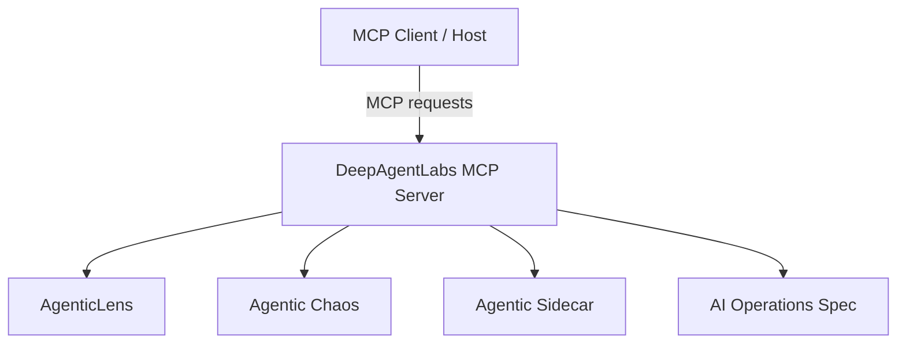

# DeepAgentLabs MCP Server

## Unified MCP interface for agentic workflows

**Version:** 0.7.0
**Maturity:** Alpha

`deep-agentic-core-mcp` is the shared MCP server layer for the DeepAgentLabs ecosystem. It provides one MCP interface for workflow analysis, resilience testing, server diagnostics, and supervision-readiness discovery.

## Integration readiness

Call `core.compatibility` for the packaged candidate baseline and local
installed distribution versions. See [release readiness](release-readiness.md)
for the tested matrix, support policy, upgrades and manual operator rollback.
Runtime readiness and hosted deployment health require separate checks.

## What it does

The MCP server brings multiple agentic capabilities together behind a single MCP interface:

- **AgenticLens** — workflow inspection, profiling, analysis, and reporting
- **Agentic Chaos** — controlled fault-injection and resilience experiments
- **Agentic Sidecar** — supervision-readiness and module discovery
- **Core diagnostics** — health, version, verification, and session information

## Unified workflows (0.4.0)

Use the core tools to combine existing evidence into a fail-closed release
decision:

```text
core.compare_runs        chaos.run_experiment (local)     Evals report
        \                        |                         /
         +------------> core.release_check <--------------+
                                 |
               core.incident_summary -> core.export_report
```

See [Unified workflows](unified-workflows.md).

## Key capabilities

### Workflow analysis

Analyze agentic workflow artifacts and inspect metrics such as:

- workflow steps
- token usage
- latency
- cost
- chaos events
- recommendations

### Workflow reports

Generate Markdown summaries of workflow execution, including step-level metrics and overall usage.

### Chaos experiments

Run controlled experiments against a target script using supported fault types such as:

- tool failure
- token timeout
- rate-limit storm
- infinite loop
- memory corruption
- silent degradation
- handoff corruption

### Server diagnostics

Inspect the MCP server's health, version, integration availability, and readiness.

### Sidecar discovery

Inspect the available Agentic Sidecar package, its status, modules, and framework adapters.

## Architecture



## AIOS 0.8 operational artifacts

See [optional operational artifact adoption](aios-0.8-operational-artifacts.md) for verification signals, audit events and investigation reports. Native contracts and supported markers remain unchanged.

See [coordinated v1.0 engineering readiness](coordinated-v1-readiness.md) for candidate scope, migration and remaining acceptance gates.
