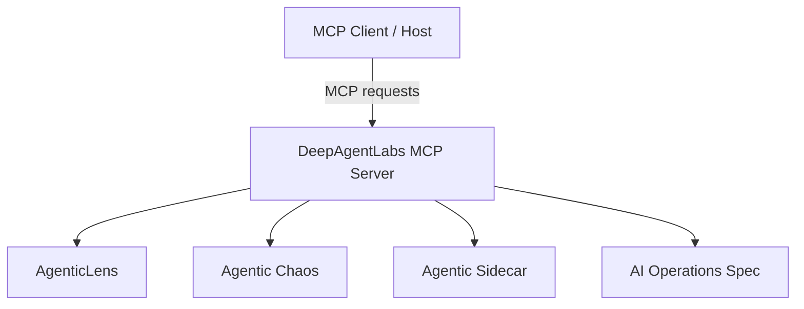

# DeepAgentLabs MCP Server

## Unified MCP interface for agentic workflows

**Version:** 0.2.0  
**Maturity:** Alpha

`deep-agentic-core-mcp` is the shared MCP server layer for the DeepAgentLabs ecosystem. It provides one MCP interface for workflow analysis, resilience testing, server diagnostics, and supervision-readiness discovery.

## What it does

The MCP server brings multiple agentic capabilities together behind a single MCP interface:

- **AgenticLens** — workflow inspection, profiling, analysis, and reporting
- **Agentic Chaos** — controlled fault-injection and resilience experiments
- **Agentic Sidecar** — supervision-readiness and module discovery
- **Agentic Evals** — native evaluation report and release-gate validation
- **Control Tower** — authenticated local operations, evidence, and recovery
- **Core diagnostics** — health, version, verification, and session information

## Choose a connection mode

| Mode | Best for | Boundary |
|---|---|---|
| Local stdio | Development, local artifacts, and chaos experiments | Runs on the trusted machine and may execute configured scripts |
| Hosted Streamable HTTP | Workflow analysis, reports, and shared access | Requires a bearer key; remote chaos execution is disabled |

The hosted service is documented in [Remote Hosting](remote-hosting.md). The
server does not automatically instrument an application: your application
exports a workflow or evaluation artifact and sends it to the MCP tools.

## Key capabilities

### Workflow analysis

Analyze agentic workflow artifacts and inspect metrics such as:

- workflow steps
- token usage
- latency
- cost
- chaos events
- recommendations

### Workflow reports

Generate Markdown summaries of workflow execution, including step-level metrics and overall usage.

### Chaos experiments

Run controlled experiments against a target script using supported fault types such as:

- tool failure
- token timeout
- rate-limit storm
- infinite loop
- memory corruption
- silent degradation
- handoff corruption

### Server diagnostics

Inspect the MCP server's health, version, integration availability, and readiness.

### Sidecar discovery

Inspect the available Agentic Sidecar package, its status, modules, and framework adapters.

## Architecture

