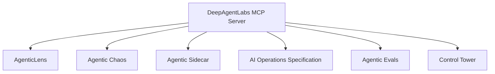

# Integrations

The MCP Server is an orchestration layer over the DeepAgentLabs ecosystem. It
exposes selected capabilities from sibling packages through one MCP tool
surface; it does not replace or reimplement those packages.

## Integration summary

| Package | MCP surface | Availability |
|---|---|---|
| AgenticLens | `lens.*` workflow analysis, reports, diagnosis, suites, ModelFit, and routing | Local and hosted, subject to the installed/pinned Lens version |
| Agentic Chaos | `chaos.*` fault catalogs, local experiments, and AIOS export | Local; remote script execution is disabled |
| Agentic Sidecar | `sidecar.status`, `sidecar.module_inventory` | Discovery/readiness only; live task control remains outside MCP |
| AI Operations Spec | `spec.validate_artifact` and schema resources | Local or hosted when canonical schema assets are available |
| Agentic Evals | `evals.validate_artifact` for native reports and gate decisions | Offline validation; Evals suites and judges still run through Evals |
| Control Tower | `tower.*` authenticated investigation and approved recovery tools | Local connector; hosted Tower credentials and write actions are restricted |

The MCP server also provides `core.*` diagnostics, sessions, prompts, and
resources shared across these integrations.

## AgenticLens

**Status:** Available

AgenticLens provides workflow inspection, analysis, comparison, reporting, and SLO-related capabilities.

The MCP Server exposes these capabilities through:

- `lens.analyze_workflow`
- `lens.report_summary`
- `lens.compare_runs`
- `lens.slo_summary`
- `lens.audit_report`

The hosted image currently pins AgenticLens `0.10.0`. Local availability is
reported dynamically by `core.health` and `core.verify`.

## Agentic Chaos

**Status:** Available

Agentic Chaos provides controlled fault-injection and resilience testing.

The MCP Server exposes:

- `chaos.list_faults`
- `chaos.run_experiment`

The hosted image currently pins Agentic Chaos `0.8.0`. Local availability is
reported dynamically by `core.health` and `core.verify`.

## Agentic Sidecar

**Status:** Experimental / scaffold

The Sidecar package is importable, but its decision runtime is not yet implemented.

The MCP Server exposes:

- `sidecar.status`
- `sidecar.module_inventory`

Sidecar discovery does not imply that a live decision runtime or enforcement
bridge is connected. Check `sidecar.status` for the installed package state.

## AI Operations Specification

**Status:** Available when canonical schema assets are installed

The MCP Server provides:

- `spec.validate_artifact`

The hosted image includes the pinned schema assets. A local checkout must make
the required schema files available to the server.

## Agentic Evals

**Status:** Available for native artifact validation

The MCP Server exposes:

- `evals.validate_artifact`

This validates native Agentic Evals reports and gate decisions against the
published schemas. It does not run Evals suites, targets, or judges; those
remain the responsibility of the `agentic-evals` package and its CLI/API.

See [the Evals contract](evals-report-contract.md) and [Evals CLI
compatibility](evals-0.8-cli.md).

## Control Tower

**Status:** Available locally through an authenticated connector

The MCP Server exposes local `tower.*` tools for Tower status, versions,
agents, posture, evidence, investigation, incident workflows, previews, and
approved execution. Tower credentials are supplied through trusted server
configuration, not MCP tool arguments. Human approval remains in the Tower
HTTP/CLI workflow, and hosted MCP calls remain restricted until per-user Tower
credentials are configured.

See [Tower fleet operations](tower-0.7-fleet-operations.md) for compatibility
boundaries.

## Integration overview

