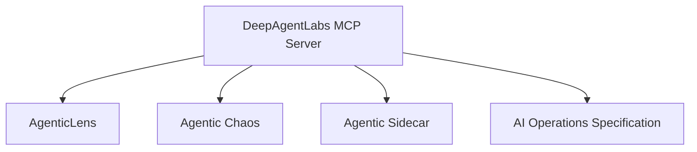

# Integrations

The MCP Server provides a unified interface over multiple DeepAgentLabs packages.

## Unified workflows (0.4.0)

The `core.compare_runs`, `core.release_check`, `core.incident_summary`, and
`core.export_report` tools compose Lens, Evals and Chaos evidence into one
workflow. They do not replace AgenticLens, Agentic Chaos, Agentic Evals, AI
Operations Spec, Sidecar, or Control Tower logic. See
[Unified workflows](unified-workflows.md).

## AgenticLens

**Status:** Available

AgenticLens provides workflow inspection, analysis, comparison, reporting, and SLO-related capabilities.

The MCP Server exposes these capabilities through:

- `lens.analyze_workflow`
- `lens.report_summary`
- `lens.compare_runs`
- `lens.slo_summary`
- `lens.audit_report`

The current compatibility target is AgenticLens `0.11.0` (`lens.optimization_analyze`). Optional imports
degrade cleanly when the package is absent or older than the requested feature.

## Agentic Chaos

**Status:** Available

Agentic Chaos provides controlled fault-injection and resilience testing.

The MCP Server exposes:

- `chaos.list_faults`
- `chaos.run_experiment`

The current compatibility target is Agentic Chaos `0.8.0`. MCP uses its
exporter and fault catalog; arbitrary chaos execution remains local-only.

## Agentic Sidecar

**Status:** Discovery only

Sidecar ships a local decision runtime, but MCP exposes only discovery; it
does not bridge Sidecar runtime controls.

The MCP Server exposes:

- `sidecar.status`
- `sidecar.module_inventory`

The verified local environment reports:

- Version: `0.8.5`
- Package status: `implemented`
- Release stage: `pre-alpha`
- Runtime ready: `true` (runtime connected to MCP: `false`)

## Agentic Evals

**Status:** Available

The MCP Server validates native Evals reports and gate decisions offline with
`evals.validate_artifact`, and `core.release_check` and `lens.slo_summary` judge
evaluation reports with the Evals release gate. The bundled schemas match
Agentic Evals `0.9.0`, unchanged in `0.10.0`, which hosted images pin.
`spec.validate_artifact` validates Runs carrying Evals 0.10.0 AIOS evaluation
evidence ([note](evals-0.10-aios-evidence.md)).

## AI Operations Specification

**Status:** Read-only compatibility surface

The MCP Server provides:

- `spec.validate_artifact`

The current compatibility target is AI Operations Specification `0.5.1`; the
MCP package bundles the canonical schemas and uses the sibling package for
optional catalog and conformance integration.

## Integration overview

