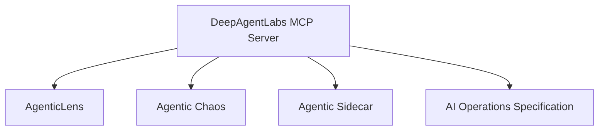

# Integrations

The MCP Server provides a unified interface over multiple DeepAgentLabs packages.

## Unified workflows (0.4.0)

The `core.compare_runs`, `core.release_check`, `core.incident_summary`, and
`core.export_report` tools compose Lens, Evals and Chaos evidence into one
workflow. They do not replace AgenticLens, Agentic Chaos, Agentic Evals, AI
Operations Spec, Sidecar, or Control Tower logic. See
[Unified workflows](unified-workflows.md).

## AgenticLens

**Status:** Available

AgenticLens provides workflow inspection, analysis, comparison, reporting, and SLO-related capabilities.

The MCP Server exposes these capabilities through:

- `lens.analyze_workflow`
- `lens.report_summary`
- `lens.compare_runs`
- `lens.slo_summary`
- `lens.audit_report`

The current compatibility target is AgenticLens `0.13.0` (including execution verification). Optional imports
degrade cleanly when the package is absent or older than the requested feature.

## Agentic Chaos

**Status:** Available

Agentic Chaos provides controlled fault-injection and resilience testing.

The MCP Server exposes:

- `chaos.list_faults`
- `chaos.run_experiment`

The current compatibility target is Agentic Chaos `0.11.0`. MCP uses its
exporter and fault catalog; arbitrary chaos execution remains local-only.

## Agentic Sidecar

**Status:** Discovery plus explicit host-bound operator stop/revoke (0.6.0)

Sidecar ships a local decision runtime. MCP model tools expose discovery;
operators can stop a live host-bound runtime through a separate authenticated
endpoint with exact task scope. See [Phase 6 setup](phase6-containment.md).

The MCP Server exposes:

- `sidecar.status`
- `sidecar.module_inventory`

The MCP 0.7 candidate baseline tests Sidecar `0.10.1`. Discovery reports
installed API readiness; it does not connect a runtime. Use the explicit host
bridge for task controls and preserve native acknowledgements/in-flight limits.

## Agentic Evals

**Status:** Available

The MCP Server validates native Evals reports and gate decisions offline with
`evals.validate_artifact`, and `core.release_check` and `lens.slo_summary` judge
evaluation reports with the Evals release gate. The bundled schemas match
Agentic Evals `0.9.0` documents (native report/gate schema 1.0), unchanged
in the tested Evals `0.12.0` release, which hosted image recipes pin.
`spec.validate_artifact` validates Runs carrying Evals 0.10.0 AIOS evaluation
evidence ([note](evals-0.10-aios-evidence.md)).

## AI Operations Specification

**Status:** Read-only compatibility surface

The MCP Server provides:

- `spec.validate_artifact`

The candidate baseline uses AIOS repository `0.7.0`, with Run/Workflow
`0.4-draft` and provenance `0.6-draft` markers. Standalone images fetch
checksum-verified v0.6.1 validator assets; explicit workspace checkouts supply
additional catalogs/conformance fixtures. Native Evals schemas are bundled
inside MCP separately from AIOS assets. See [asset revisions](release-readiness.md).

## Integration overview

## MCP 0.7 acceptance baseline

See [release readiness](release-readiness.md) for all sibling pins, the MCP SDK
baseline, AIOS asset revisions and the remote Tower contract boundary.
`core.compatibility` observes installed distributions; adapters may use explicit
workspace checkouts. Native sibling schemas, optional dependency ranges and
producer evidence ownership remain unchanged.
