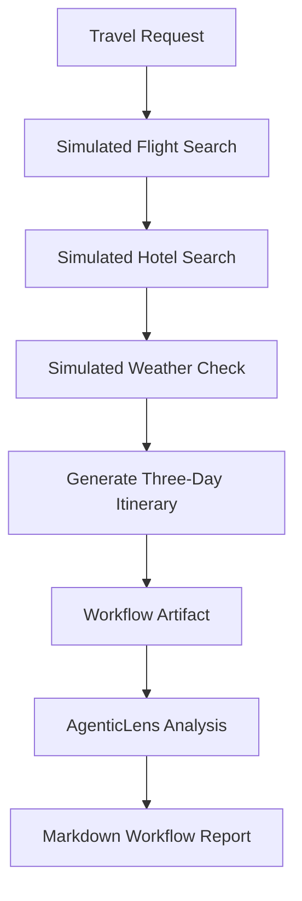

# AI Travel Planner: Workflow Analysis and Reporting

## 1. Title and Summary

This use case demonstrates an AI Travel Planner workflow using simulated travel data and the existing DeepAgentLabs MCP Server.

The planner simulates flight search, hotel search, weather checking, and itinerary generation for a three-day trip from Bengaluru to Goa. AgenticLens is then used to analyze the workflow and generate a report.

**Important:** All travel data is simulated. No real external travel APIs are called, and no bookings are made.

## 2. At a Glance

| Item | Details |
|---|---|
| Use case | AI Travel Planner |
| Package | DeepAgentLabs MCP Server |
| Tested server version | 0.3.0 |
| AgenticLens version | 0.5.0 |
| Main capabilities | Workflow analysis and reporting |
| Data source | Simulated |
| Workflow steps | 4 |

## 3. Problem

Travel planning involves coordinating multiple activities, including searching for flights, finding accommodation, checking weather conditions, and preparing an itinerary.

This example represents those activities as a four-step workflow. AgenticLens helps inspect the workflow artifact and produce a structured summary of its reported metrics.

The example demonstrates workflow observability rather than a real travel booking system.

## 4. Architecture and Flow



The Python demo generates simulated travel results. A representative workflow artifact is submitted separately to the MCP server's AgenticLens tools.

## 5. Prerequisites

- Python installed.
- The DeepAgentLabs MCP Server repository cloned locally.
- Project dependencies installed according to the repository instructions.
- The MCP server and MCP Inspector running locally.
- AgenticLens available through the MCP server.
- The `travel_planner_demo.py` script in the `mcp-server` project folder.

Confirm the server status using `core.health`. In the tested environment, the server reported version 0.3.0, AgenticLens 0.5.0, and Agentic Chaos 0.4.0.

## 6. Step-by-Step Walkthrough

### Step 1: Run the travel planner

From the project directory containing `travel_planner_demo.py`, run:

```bash
python travel_planner_demo.py
```

The program prints simulated flight options, hotel options, a weather forecast, and a three-day itinerary.

### Step 2: Analyze the workflow

Open MCP Inspector and select `lens.analyze_workflow`.

Submit a workflow artifact containing four steps:

1. Search flights.
2. Search hotels.
3. Check weather.
4. Generate itinerary.

Each step includes example token, cost, latency, and metadata fields. The artifact used in this demonstration contains illustrative metrics rather than measurements automatically collected from the Python script.

### Step 3: Generate a report

Select `lens.report_summary` and submit the same workflow artifact.

The tool returns a structured workflow summary and a Markdown report describing the four steps and their supplied metrics.

### Step 4: Evaluate a sample report

Select `lens.slo_summary` and submit an `EvaluationReport` containing a suite name, suite version, summary, and cases.

For this demonstration, the evaluation metrics were supplied as sample values. The tool returned a passing decision for the configured thresholds.

### Step 5: Inspect the evaluation report

Select `lens.audit_report` and submit the compatible evaluation report.

The tool accepts the report and returns its evaluation summary. The example report contains an empty `cases` array, so it must not be interpreted as evidence that four real test cases were executed.

### Step 6: Explore fault-testing capabilities

Select `chaos.list_faults` to inspect available fault types.

Then use `chaos.run_experiment` with the local path to `travel_planner_demo.py`, the `tool_failure` fault selection, and a timeout of 10 seconds.

The recorded experiment completed without a crash or timeout and returned an empty `chaos_events` list. Fault injection was not confirmed by this result.

## 7. Expected Output

The Python script should print the travel request and simulated results for all four workflow steps.

The tested `lens.analyze_workflow` call returned:

- Workflow name: AI Travel Planner
- Steps: 4
- Total tokens: 990
- Reported cost: approximately USD 0.0068
- Reported latency: 4 seconds
- Recommendations: 0
- Chaos events: 0

These token, cost, and latency values were entered manually in the example artifact. They are illustrative and are not measured performance results from the Python demo.

The `lens.report_summary` tool also returned a Markdown report with a summary table and individual step metrics.

## 8. Verify It Worked

Check that:

- The Python script finishes and prints the four simulated workflow steps.
- `lens.analyze_workflow` returns `ok: true`.
- `lens.report_summary` returns `ok: true` and a Markdown report.
- `lens.slo_summary` returns a threshold decision for the supplied evaluation report.
- `lens.audit_report` accepts the compatible report structure.
- `chaos.run_experiment` returns an experiment result that can be inspected.

A successful tool response confirms that the request was processed. It does not independently verify the realism of simulated data, actual production performance, or successful fault injection.

## 9. Cleanup

- Stop the local MCP Inspector and MCP server when finished.
- Keep the example script and recorded outputs if they are needed for documentation.
- Remove temporary artifacts only if they are no longer needed.
- No real bookings, external travel API calls, or external resources need to be cleaned up.

## 10. Variations and Next Steps

- Change the destination and simulated itinerary.
- Add more simulated workflow steps.
- Compare measured execution metrics with explicitly labelled illustrative metrics.
- Explore additional AgenticLens reporting capabilities.
- Test Agentic Chaos with a workflow that can demonstrate and record an actual injected fault.
- Explore `lens.compare_runs` after preparing compatible baseline and candidate run objects in the same session.

## 11. Tested With

| Component | Tested configuration |
|---|---|
| MCP server | 0.3.0 |
| AgenticLens | 0.5.0 |
| Agentic Chaos | 0.4.0 |
| Python demo | `travel_planner_demo.py` |
| MCP client | MCP Inspector 2.10.1 |
| Data | Simulated travel data |
| Verification | Local tool calls and captured responses |

The configuration above describes the observed environment. Re-run the example in a fresh environment before claiming independent clean-install reproducibility.