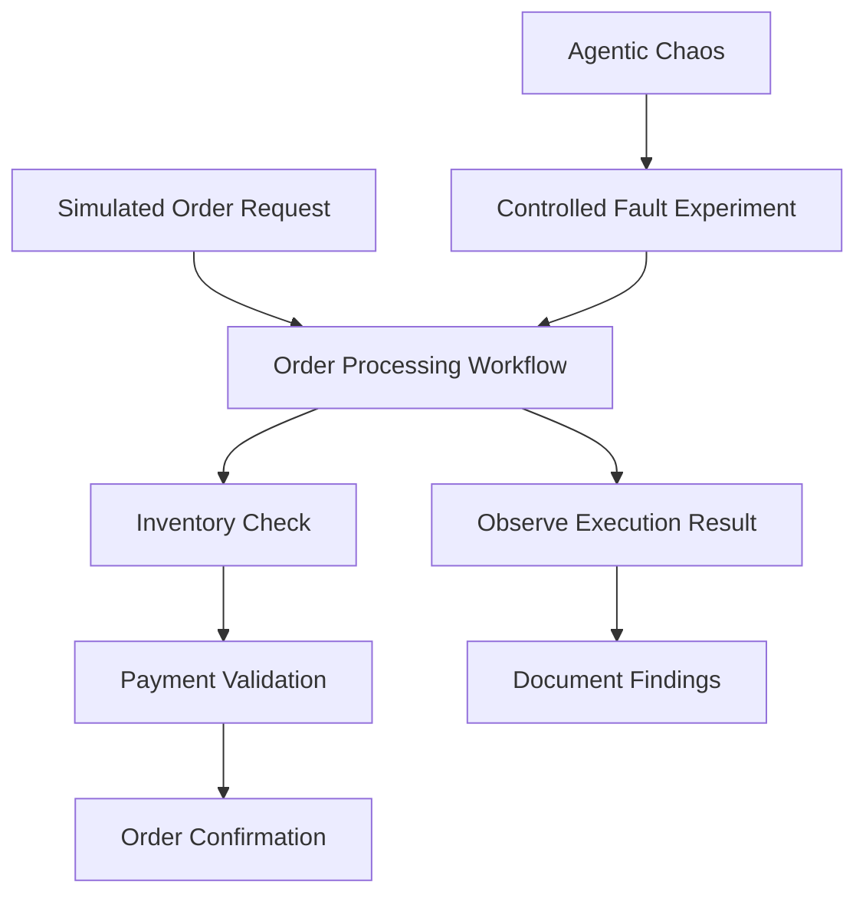

# Workflow Fault Testing: Testing AI Workflow Resilience

## 1. Title and Summary

This use case demonstrates how developers can test an AI workflow's resilience using the existing Agentic Chaos capabilities exposed through the DeepAgentLabs MCP Server.

A simulated order-processing assistant is used to explore how controlled fault injection can help evaluate workflow behavior. All order data is simulated; no real orders or external transactions are involved.

## 2. At a Glance

| Item | Details |
|---|---|
| Use case | Workflow Fault Testing |
| Scenario | AI order-processing assistant |
| Main capability | Agentic Chaos |
| MCP tools | `chaos.list_faults`, `chaos.run_experiment` |
| Data | Simulated |
| Goal | Explore workflow behavior during controlled fault experiments |

## 3. Problem

AI workflows often depend on multiple tools and processing steps. If a tool fails, times out, or returns unexpected results, the workflow may not complete as expected.

Developers need a way to experiment with controlled failures and observe the resulting behavior before relying on a workflow in a real environment.

This use case explores how Agentic Chaos can support that testing process.

## 4. Architecture and Flow

The order-processing workflow is a demonstration scenario. Agentic Chaos performs experiments using the configured script and supported fault options; the diagram does not imply that every fault automatically affects every workflow step.

## 5. Prerequisites

- A working local DeepAgentLabs MCP Server setup.
- MCP Inspector connected to the server.
- Access to the existing `chaos.list_faults` and `chaos.run_experiment` tools.
- A local demonstration script that is safe to execute.

**Safety note:** `chaos.run_experiment` executes code. Use only a script you understand and control, and review the repository's security guidance before running experiments.

## 6. Step-by-Step Walkthrough

### Step 1: Discover available faults

In MCP Inspector, select `chaos.list_faults` and execute it using the tool's displayed input schema.

Review the returned fault names and descriptions. Available faults may include tool failures, timeouts, rate-limit storms, and other controlled disruptions, depending on the installed package version.

### Step 2: Prepare the demonstration scenario

Use a local script to represent an order-processing assistant. The scenario can include simulated inventory, payment-validation, and order-confirmation steps.

Keep all inputs and outputs local to the demonstration. Do not use real payment credentials or process actual transactions.

### Step 3: Run a controlled experiment

Select `chaos.run_experiment` in MCP Inspector and provide the required arguments according to its displayed schema.

Use the path to your local demonstration script, select a supported fault, and choose an appropriate timeout. Execute only after checking the arguments and script path.

### Step 4: Inspect the result

Record the actual response returned by the MCP Server. Check whether the experiment completed, timed out, crashed, or reported any chaos events.

Do not assume a fault was successfully injected just because the tool returned `ok: true`. Check the actual experiment result.

### Step 5: Document the findings

Record the selected fault, script used, returned status, observed events, and any limitations. If no fault event was reported, document that result accurately rather than claiming the workflow failed.

## 7. Expected Output

The tool response should provide experiment information such as its identifier, execution times, reported chaos events, crash status, and timeout status, depending on the server implementation.

The exact output depends on the script, selected fault, and runtime environment. Capture the actual MCP Inspector response here after running the experiment.

**Important:** This use case does not claim that a fault was successfully injected until the returned result confirms it.

## 8. Verify It Worked

- Confirm that `chaos.list_faults` returns the available fault information.
- Confirm that `chaos.run_experiment` accepts the supplied arguments and returns an experiment result.
- Check the returned `chaos_events`, `crashed`, and `timed_out` fields.
- Save the real response for documentation.
- If the experiment reports no fault events, record that outcome honestly.

## 9. Cleanup

- Stop the local MCP Inspector and server when finished.
- Stop any demonstration processes started for the experiment.
- Remove temporary artifacts only when they are no longer needed.
- Confirm that no real orders, payments, or external transactions were performed.

## 10. Variations and Next Steps

- Test another supported fault using a controlled local script.
- Compare the behavior of a workflow before and during an experiment.
- Add explicit error handling to the simulated workflow and repeat the experiment.
- Document which failures were observed and which could not be reproduced.
- Explore combining experiment results with AgenticLens reporting where compatible inputs are available.

## 11. Tested With

| Component | Tested configuration |
|---|---|
| MCP Server | Record the version used during testing |
| Agentic Chaos | Record the installed package version |
| MCP Inspector | Record the version used |
| Demonstration | Simulated order-processing workflow |
| Results | Add the actual experiment output after execution |

