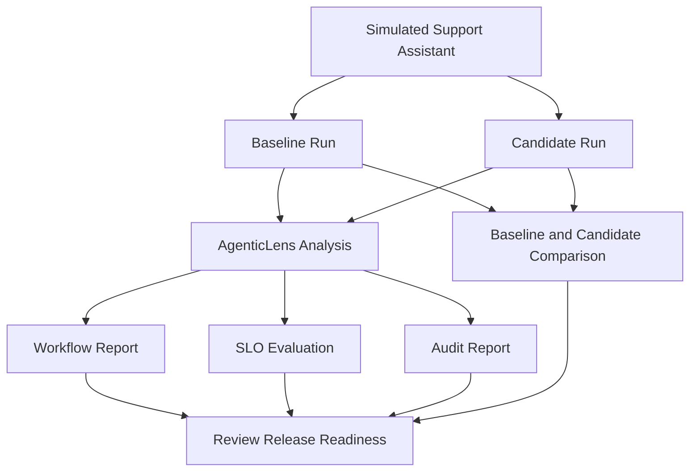

# AI Workflow Evaluation and Release Readiness

## 1. Title and Summary

This use case demonstrates how developers can evaluate an AI workflow using the existing AgenticLens capabilities exposed through the DeepAgentLabs MCP Server.

A simulated AI customer-support assistant is used to illustrate workflow analysis, reporting, service-level objective (SLO) evaluation, audit reporting, and baseline-versus-candidate comparison.

The example uses demonstration data. It does not represent measurements from a production system.

## 2. At a Glance

| Item | Details |
|---|---|
| Use case | AI Workflow Evaluation and Release Readiness |
| Scenario | AI customer-support assistant |
| Main capability | AgenticLens |
| MCP tools | `lens.analyze_workflow`, `lens.report_summary`, `lens.slo_summary`, `lens.audit_report`, `lens.compare_runs` |
| Data | Simulated evaluation data |
| Goal | Evaluate workflow performance and identify possible regressions |

## 3. Problem

An AI workflow may appear to work correctly while using more tokens, costing more, or taking longer to complete after a change.

Developers need a repeatable way to inspect workflow execution, review performance metrics, and compare a candidate run against a baseline before release.

This use case explores how AgenticLens can support that evaluation process.

## 4. Architecture and Flow

The workflow runs and metrics are illustrative. AgenticLens processes the inputs supplied to its tools; it does not automatically collect production measurements from this simulated assistant.

## 5. Prerequisites

- A working local DeepAgentLabs MCP Server setup.
- MCP Inspector connected to the server.
- Access to the available AgenticLens tools.
- A compatible workflow artifact and report data.
- Baseline and candidate run objects that match the input schema expected by `lens.compare_runs`.

## 6. Step-by-Step Walkthrough

### Step 1: Prepare the example workflow

Use a simulated customer-support assistant that receives a customer question, retrieves relevant information, and generates a response.

Prepare example run data containing relevant metrics, such as token usage, cost, latency, and step count. Clearly label these values as simulated.

### Step 2: Analyze the workflow

Select `lens.analyze_workflow` in MCP Inspector and submit a valid workflow artifact according to the tool's input schema.

Record the actual response, including the workflow summary, step count, metrics, and any recommendations returned.

### Step 3: Generate the report summary

Select `lens.report_summary` and provide the report or workflow reference required by its input schema.

Save the returned report and note the metrics and findings it actually contains.

### Step 4: Evaluate service-level objectives

Select `lens.slo_summary` and provide a compatible report object with the required fields.

Review the returned evaluation against the configured thresholds. Do not claim that an SLO passed or failed until the tool's response confirms the result.

### Step 5: Generate an audit report

Select `lens.audit_report` and provide the required arguments.

Record the actual audit output and any issues or findings reported.

### Step 6: Compare baseline and candidate runs

Prepare two compatible run objects:

- **Baseline:** the reference version of the simulated support workflow.
- **Candidate:** a changed version of the same workflow, with different illustrative metrics.

Select `lens.compare_runs` and supply both objects using the exact input structure shown by the tool schema. If the server supports stored runs in the current session, follow the tool's documented session behavior.

Record the comparison output, including any regression indicators or errors.

### Step 7: Review release readiness

Review the analysis, report, SLO evaluation, audit results, and run comparison together.

Use the findings to decide what needs further investigation. The example demonstrates an evaluation workflow; it does not automatically approve a production release.

## 7. Expected Output

Depending on the supplied inputs and tool behavior, the results may include:

- Workflow metrics and recommendations.
- A formatted report summary.
- SLO evaluation results.
- Audit findings.
- Baseline-versus-candidate comparison results.

Capture the actual response from each tool during testing. Do not invent results or assume that every tool will succeed for every input.

## 8. Verify It Worked

- Confirm that the workflow artifact is accepted by `lens.analyze_workflow`.
- Check that `lens.report_summary` returns a report for the supplied data.
- Verify that the SLO and audit tools accept compatible input objects.
- Confirm that `lens.compare_runs` receives both a valid baseline and candidate.
- Record actual results, validation errors, and limitations.
- Keep simulated metrics clearly distinguished from measured execution data.

## 9. Cleanup

- Stop MCP Inspector and the local MCP Server when finished.
- Keep example inputs and outputs only if they are needed for reproducible documentation.
- Remove temporary files when they are no longer required.
- No production system or real customer data is needed.

## 10. Variations and Next Steps

- Change the candidate's illustrative latency or token usage to explore comparisons.
- Test different SLO thresholds using compatible report inputs.
- Compare a baseline and candidate produced by repeatable local executions.
- Use measured values instead of illustrative metrics when actual instrumentation is available.
- Combine workflow evaluation with the fault-testing scenario from Use Case 2.

## 11. Tested With

| Component | Tested configuration |
|---|---|
| MCP Server | Record the version used during testing |
| AgenticLens | Record the installed package version |
| MCP Inspector | Record the version used |
| Scenario | Simulated AI customer-support assistant |
| Results | Add actual tool outputs after testing |

